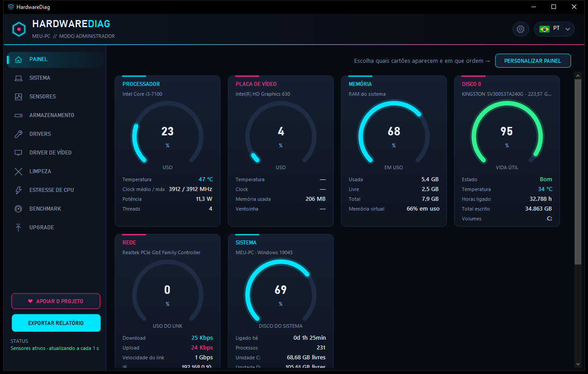
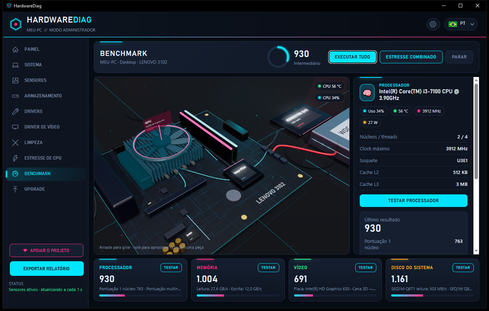
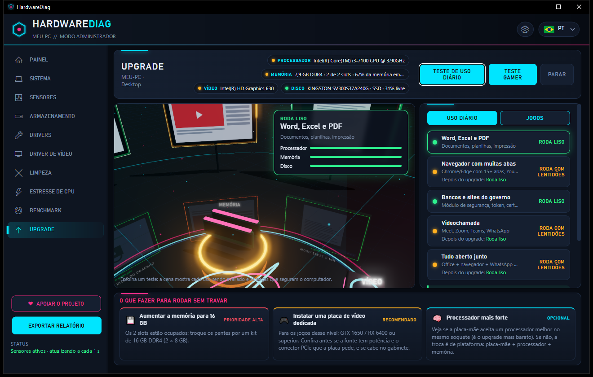
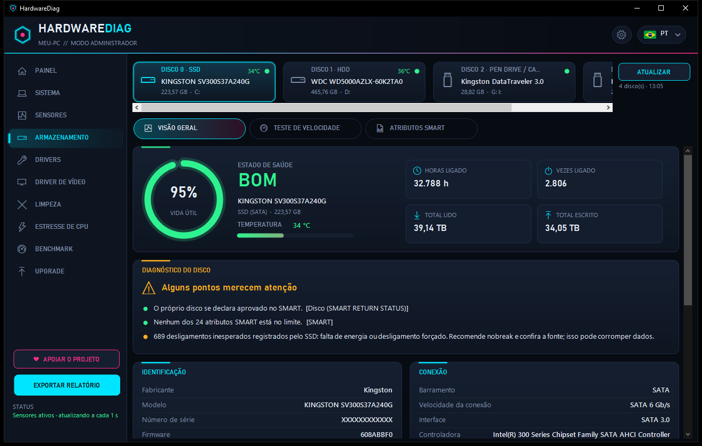
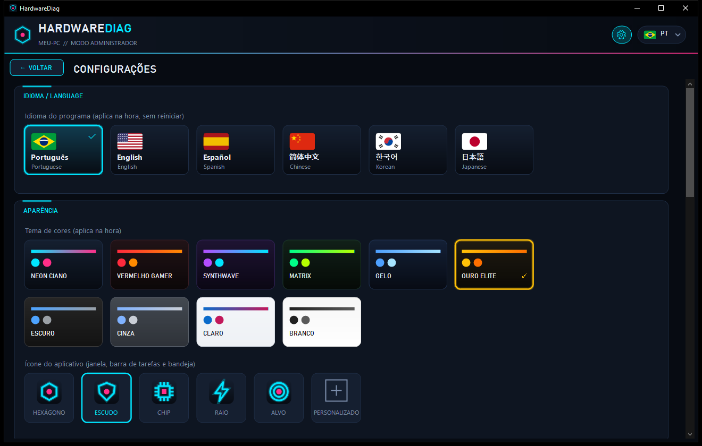

<div align="center">


# HardwareDiag

**Diagnóstico completo de hardware para Windows: sensores ao vivo, saúde dos discos (SMART), drivers, benchmark 3D e recomendações de upgrade, tudo em um programa só e grátis.**

[](https://github.com/Isago2508/HardwareDiag/releases/latest)
[](https://isago2508.github.io/HardwareDiag/)
[](https://github.com/Isago2508/HardwareDiag/releases)




</div>

---

## Sobre

O **HardwareDiag** é um programa gratuito de diagnóstico de PC para Windows, feito para técnicos de informática
e para quem quer entender de verdade o próprio computador. Ele lê o hardware direto da fonte (sensores da placa-mãe,
SMART dos discos, tabela SMBIOS do firmware) e mostra tudo numa interface neon, rápida e fácil de ler.
Também gera relatórios prontos para enviar ao cliente.

## Telas

| Benchmark com a placa-mãe do seu PC em 3D | Upgrade: o que trocar para rodar sem travar |
| :---: | :---: |
|  |  |
| **Saúde do disco: SMART, vida útil e diagnóstico** | **Configurações: idiomas, temas e gráficos 3D** |
|  |  |

## Recursos

| Área | O que faz |
| --- | --- |
| **Painel** | Medidores de CPU, vídeo, memória, discos, rede, ventoinhas e bateria, com gráfico ao vivo. Personalizável |
| **Sistema** | Sistema operacional, processador, placa-mãe, BIOS, cada pente de memória e placa de vídeo |
| **Sensores** | Temperaturas, clocks, uso, tensões, potência e ventoinhas em tempo real, com mínimo e máximo |
| **Armazenamento** | Saúde, vida útil, temperatura, horas ligado, tabela SMART e teste de velocidade. Tipo exato do disco: SSD SATA 2,5", M.2, mSATA, NVMe com velocidade PCIe, HD com RPM |
| **Drivers** | Versão, data e assinatura de cada driver; atualização pelo Windows Update, backup e remoção |
| **Driver de vídeo** | Download do driver oficial (NVIDIA, AMD, Intel) e instalação limpa com ponto de restauração |
| **Limpeza** | Temporários, cache do Windows Update, miniaturas, relatórios de erro, caches de navegadores e mais |
| **Estresse de CPU** | Carga em todos os núcleos com verificação de erros e parada automática por temperatura |
| **Benchmark** | Testes de processador, memória, vídeo e disco com a placa-mãe do seu PC em 3D |
| **Upgrade** | Teste de uso diário e teste gamer: mostra o que trocar para o computador rodar sem travar |
| **Exportar relatório** | Escolha o que entra (Básico ou Completo) e o formato: PDF, HTML, TXT ou JSON |

### Destaques

- **Slots de memória exatos:** lidos da tabela SMBIOS do firmware, inclusive os vazios, com o nome de cada slot na placa.
- **Gráficos 3D ajustáveis:** níveis Leve, Normal e Ultra, para PCs fracos ou máquinas parrudas.
- **6 idiomas:** português, inglês, espanhol, chinês, coreano e japonês, trocando na hora, sem reiniciar.
- **10 temas de cores** e ícones personalizáveis.
- **Atualização automática:** em Configurações → Atualizações, baixa a versão nova daqui do GitHub, confere o arquivo e reinicia já atualizado.
- **Privacidade:** seus dados não saem do computador (ficam em `%LOCALAPPDATA%\HardwareDiag`). O programa só consulta este repositório para saber se há versão nova.

## Download e instalação

1. Baixe o **`Instalar_HardwareDiag_1.0.2.exe`** em [Releases](https://github.com/Isago2508/HardwareDiag/releases/latest).
2. Abra o arquivo. Se aparecer "O Windows protegeu o computador", clique em **Mais informações → Executar assim mesmo**.
   O aviso aparece porque o programa é novo e ainda não tem assinatura digital.
3. Siga o assistente de instalação. Não é preciso instalar o .NET nem o driver PawnIO: ele já vem junto e é instalado sozinho.

**Requisitos:** Windows 10 ou 11 (64 bits), executar como administrador (o programa já pede) e o Microsoft Edge WebView2,
que já vem no Windows atualizado.

## ❤ Apoie o projeto

O HardwareDiag é gratuito. Se ele te ajudou, considere fazer uma doação de qualquer valor:
isso mantém o projeto vivo e com novidades. Você também pode doar direto no programa, no botão **Apoiar o projeto**.

<table>
<tr>
<td></td>
<td>

**Pix** (você escolhe o valor)

Abra o app do seu banco, escolha **Pix → Ler QR Code** e aponte para o código ao lado.

Ou use a chave aleatória:
```
e13a548a-f773-4d9b-9c38-9045307f28f6
```

Outra forma de ajudar: dê uma ⭐ no repositório.

</td>
</tr>
</table>

## Compilar a partir do código

Pré-requisito: [.NET 9 SDK](https://dotnet.microsoft.com/download/dotnet/9.0).

```bash
dotnet build src/HardwareDiag -c Release -p:Marca=Generica
```

Executável único, que roda sem o .NET instalado:

```bash
dotnet publish src/HardwareDiag -c Release -r win-x64 --self-contained -p:Marca=Generica -p:PublishSingleFile=true -p:IncludeNativeLibrariesForSelfExtract=true -o publish
```

## Linha de comando

| Comando | O que faz |
| --- | --- |
| `HardwareDiag.exe --report relatorio.html` | Gera o relatório sem abrir a janela (`.html`, `.txt`, `.json` ou `.pdf`) |
| `HardwareDiag.exe --disk-dump discos.txt` | Relatório técnico de todos os discos, com os dados brutos |
| `HardwareDiag.exe --minimized` | Inicia escondido na bandeja do sistema |

## Suporte

Encontrou um problema ou tem uma sugestão? Abra uma [issue](https://github.com/Isago2508/HardwareDiag/issues).

---

<sub>Licenças de componentes: [THIRD_PARTY_NOTICES.md](THIRD_PARTY_NOTICES.md)</sub>
